<a href="https://www.dahhanenterprises.com"><picture><source media="(max-width: 640px)" srcset="./assets/banner-mobile.svg" /></picture></a>

<b>Dahhan Enterprises</b> · <a href="https://github.com/M1D0-Technologies/dahhan-industries">Dahhan Industries</a> · <a href="https://github.com/M1D0-Technologies/miss-dantella">Miss Dantella</a> · <a href="https://github.com/M1D0-Technologies/m1d0-technologies">M1D0 Technologies</a> · <a href="https://github.com/M1D0-Technologies/platform-engineering">Platform Engineering</a> · <a href="https://github.com/M1D0-Technologies">Organization</a>

# Dahhan Enterprises

With commercial roots tracing back to Dahhan in 1990, Dahhan Enterprises serves as the international-facing corporate identity connecting businesses across manufacturing, trade, commerce and technology.

That heritage began in industrial textiles and wholesale, where understanding products and markets, securing reliable supply, coordinating production and building lasting commercial relationships formed the foundation of the business. These principles continue to shape its development across different industries and markets.

Today, Dahhan Enterprises brings together three distinct business identities: Dahhan Industries, focused on industrial textiles, manufacturing and B2B supply; Miss Dantella, specializing in lingerie, nightwear, wholesale and ecommerce; and M1D0 Technologies, focused on business and digital transformation, technology strategy, enterprise architecture, automation and AI.

Each business maintains its own specialization, market focus and commercial activities. Dahhan Enterprises provides a unified corporate presence and a central point of reference, connecting customers, suppliers and partners with the business best suited to their needs.

Across these businesses, the commitment remains consistent: build trusted relationships, maintain dependable operations, pursue long-term development and apply technology where it creates meaningful business value.

## At a glance

<picture><source media="(max-width: 640px)" srcset="./assets/glance-mobile.svg" /></picture>

## The businesses

Each business maintains its own specialization, market focus and commercial activities.

<a href="https://github.com/M1D0-Technologies/dahhan-industries"><picture><source media="(max-width: 640px)" srcset="./assets/tiles/repo-di-mob.svg" /></picture></a><a href="https://github.com/M1D0-Technologies/miss-dantella"><picture><source media="(max-width: 640px)" srcset="./assets/tiles/repo-md-mob.svg" /></picture></a><a href="https://github.com/M1D0-Technologies/m1d0-technologies"><picture><source media="(max-width: 640px)" srcset="./assets/tiles/repo-m1d0-mob.svg" /></picture></a>

## Links

<a href="https://www.dahhanenterprises.com"><picture><source media="(max-width: 640px)" srcset="./assets/tiles/web-mob.svg" /></picture></a><a href="https://www.linkedin.com/company/dahhan-enterprises/"><picture><source media="(max-width: 640px)" srcset="./assets/tiles/li-mob.svg" /></picture></a>

Documentation and showcase material only; product source code is kept private. © 2026 Dahhan Enterprises LLC. All rights reserved.
